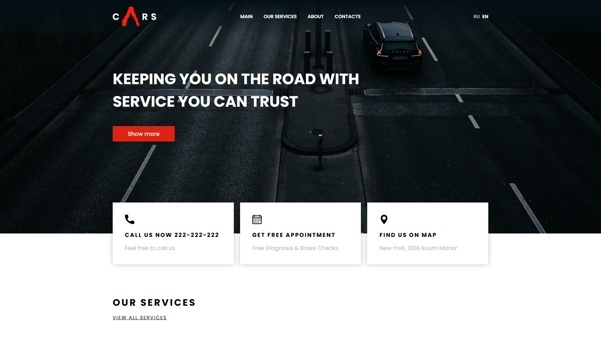

# 🔧 CARS — лендинг автосервиса

Адаптивный лендинг автосервиса «Keeping you on the road with service you can trust», свёрстанный с нуля по макету Figma. Карточки услуг с оверлеями, форма обратной связи, переключатель языка, бургер-меню.

[>>> Открыть сайт <<<](https://pavelreb.github.io/Car_Repair/)



## ✨ Что внутри

- 🖥️ **Первый экран** с оффером и кнопкой «Show more»
- 📇 **Контакт-карточки** — звонок, запись, адрес
- 🛠️ **Our Services** — Diagnostic, Tires & Wheels, Engines с hover-оверлеями
- 🏢 **About** — о компании и ASE-сертификации мастеров
- ⚡ **Fast & Easy** — процесс работы в три шага
- 📩 **Contact us** — форма с плавающими лейблами
- 🍔 **Бургер-меню**, плавный скролл, липкая шапка, переключатель RU/EN

## 🛠️ Технологии

| Технология | Применение |
|------------|-----------|
| **HTML5** | Семантическая разметка |
| **CSS3 (Flexbox / Grid)** | Раскладка секций и карточек |
| **Media Queries** | Адаптив под десктоп, планшет и мобильные |
| **JavaScript (ES6)** | Меню, скролл, липкий хедер — без библиотек |
| **Figma** | Вёрстка по макету |

## ⚡ Оптимизация

- Продакшен-версия (`index.html` + `css/index.css` + `js/index.js`) минифицирована
- Читаемые исходники рядом: `main.html`, `css/main.css`, `js/main.js`
- Сжатые изображения (`*-min.jpg`), локальные шрифты, полный набор favicon

## 🚀 Запуск

Сборка не требуется — достаточно открыть `index.html` в браузере или развернуть на любом статическом хостинге (GitHub Pages, Netlify, Vercel).

## 📁 Структура

```
Car_Repair/
├── index.html      # Продакшен (минифицирован)
├── main.html       # Исходник
├── css/            # index.css (min) + main.css / media.css / fonts.css / reset.css
├── js/             # index.js (min) + main.js
├── fonts/          # Локальные шрифты
└── img/            # Изображения, SVG, фавиконки
```
